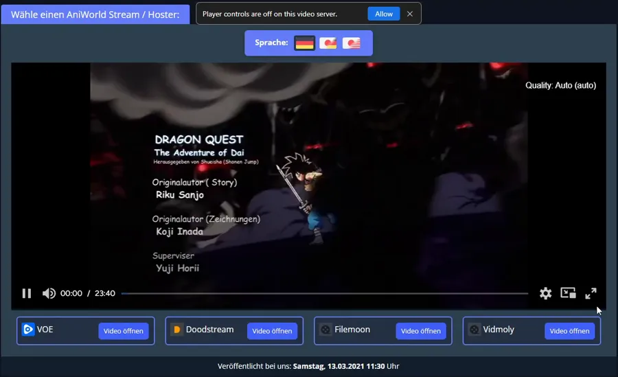
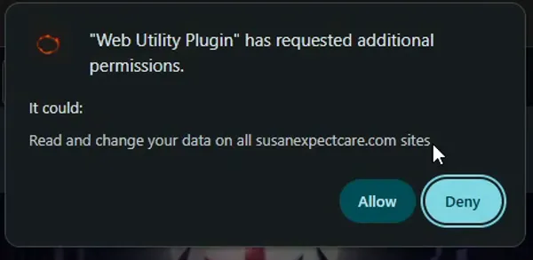
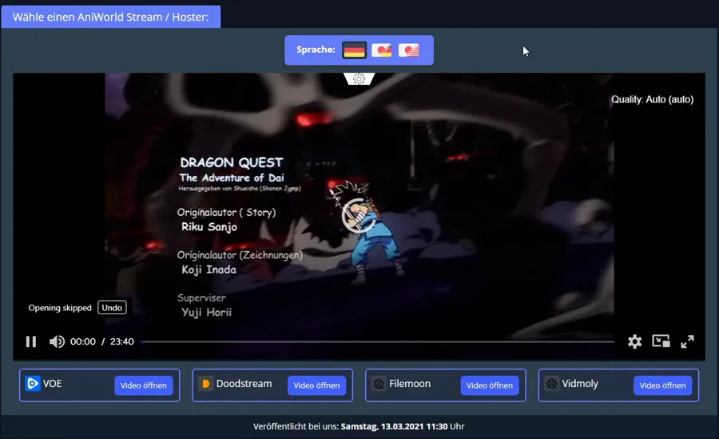
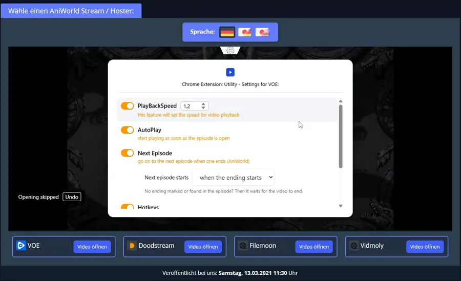

# AniWorld: Der blaue Hinweis über dem VOE-Player

Kurz: Auf AniWorld erscheint manchmal über dem Player ein Hinweis „Player controls are off on this video server.“ Mit einem Klick auf **Allow** schaltest du die Erweiterung für diesen Player frei. Danach hast du Geschwindigkeit, Autoplay, „Nächste Folge“ und Co. auch im VOE-Player.

## Was ist das?

VOE ist ein Video-Hoster. AniWorld zeigt seine Videos in einem kleinen Fenster auf der Folgenseite (ein „eingebetteter Player“). VOE wechselt die Adresse dieses Players immer wieder. Chrome erlaubt der Erweiterung aber nur, auf Adressen zu arbeiten, die du ihr erlaubt hast. Auf einer neuen Adresse ist sie deshalb zuerst aus. Der Hinweis fragt dich um Erlaubnis.

## So läuft es ab

**1. Der Hinweis erscheint**

Du öffnest eine Folge auf aniworld.to und wählst VOE. Läuft die Erweiterung auf der aktuellen VOE-Adresse noch nicht, erscheint oben der Hinweis. Das Video spielt trotzdem. Nur die Zusatzfunktionen fehlen noch.

Er erscheint also nur:
- auf aniworld.to,
- mit dem Hoster VOE,
- wenn die Player-Adresse neu ist (oder du sie früher nicht freigegeben hast).

Auf einer schon freigegebenen Adresse erscheint er nicht.

**2. Du klickst auf „Allow“**

Mit dem Kreuz schließt du den Hinweis, ohne etwas freizugeben.

**3. Chrome fragt nach**

Chrome zeigt seine eigene Frage. Dort steht die Adresse des Players (hier ein Beispiel, bei dir steht eine andere). Mit **Allow** erlaubst du der Erweiterung, auf genau dieser Adresse zu arbeiten, auf keiner anderen. Mit **Deny** passiert nichts, der Hinweis kommt beim nächsten Mal wieder.

**4. Der Player lädt neu, das Zahnrad ist da**

Der Player startet kurz neu. Oben in der Mitte sitzt jetzt das kleine Zahnrad der Erweiterung.

**5. Einstellungen**

Ein Klick aufs Zahnrad öffnet die Einstellungen: Geschwindigkeit, Autoplay, „Nächste Folge“ (wann sie startet, stellst du dort ein) und Tastenkürzel. Die Werte gelten für alle VOE-Adressen.

## Gut zu wissen

- **Einmal pro Adresse.** Die Freigabe bleibt, auch nach einem Neustart von Chrome. Wechselt VOE die Adresse, fragt der Hinweis wieder.
- **Warum kein „alle Websites“?** Die Erweiterung verlangt bewusst nicht pauschal Zugriff auf alles. Du gibst nur die eine Player-Adresse frei.
- **Zurücknehmen:** `chrome://extensions` → Erweiterung → „Details“ → „Websitezugriff“ (englisches Chrome: „Details“ → „Site access“). Entfernst du dort die Adresse, ist sie wieder aus und der Hinweis kommt zurück.
- **VOE direkt im eigenen Tab** (nicht in AniWorld eingebettet): Das Zahnrad gibt es nur auf einer Adresse, die du vorher über AniWorld freigegeben hast.
- Der Hinweis ist nur auf Englisch.
